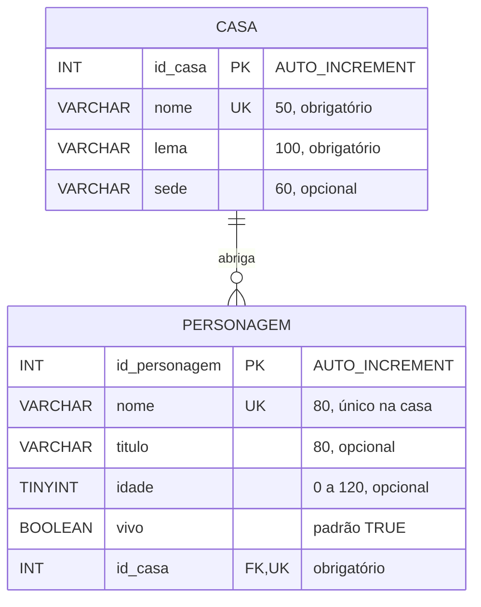

# Script SQL passo a passo — o banco de dados de Westeros

Página interativa (mobile-first) que constrói, comando a comando, o script **MySQL** de um banco com duas tabelas relacionadas: as grandes casas de *Game of Thrones* e os seus personagens. Cada passo mostra o comando, explica cada parte, a resposta do MySQL e como a tabela fica depois.

**▶ Acesse:** https://cidandrade.github.io/script-sql-westeros/

Material da disciplina **Modelagem de Banco de Dados** — Prof. Cid Andrade (UNICID).

## O modelo



- Cada personagem pertence a **exatamente uma** casa; uma casa tem **zero ou muitos** personagens.
- A relação 1:N vira a chave estrangeira `id_casa` na tabela `personagem`, com `ON DELETE RESTRICT`.

## O que a página cobre

| # | Comando | Destaque |
|---|---------|----------|
| 1 | `DROP DATABASE IF EXISTS` / `CREATE DATABASE` | `utf8mb4`, collation, script reexecutável |
| 2 | `USE` | banco padrão da sessão |
| 3 | `DROP TABLE IF EXISTS` / `CREATE TABLE casa` | `PRIMARY KEY`, `UNIQUE`, `CHECK`, `NOT NULL`, constraints nomeadas |
| 4 | `DROP TABLE IF EXISTS` / `CREATE TABLE personagem` | `DEFAULT`, `UNIQUE` composta, `FOREIGN KEY ... ON DELETE RESTRICT ON UPDATE CASCADE` |
| 5 | `INSERT INTO` | um registro |
| 6–7 | `INSERT INTO` | vários registros num só comando |
| 8 | `SELECT` + `INNER JOIN` | consulta **C01** |
| 9–10 | `UPDATE` | uma coluna; várias colunas com expressão |
| 11 | `DELETE` | barrado pela FK (`ERROR 1451`) |
| 12 | `DELETE` | o filho antes do pai |
| 13 | `SELECT` + `LEFT JOIN` + `GROUP BY` | consulta **C02** (KPI) |
| 14 | `DELETE` | agora o pai sai |

Toda consulta segue o cabeçalho:

```sql
-- C01 - O que a consulta faz
-- Atende: a que problema ou KPI ela responde
```

## Arquivos

- `index.html` — a página (arquivo único; usa Google Fonts e Mermaid via CDN).
- `westeros.sql` — o script completo, pronto para rodar (também pode ser baixado pela página).
- `der.mmd` — o DER em Mermaid; cole em [mermaid.live](https://mermaid.live) para editar ou exportar como imagem.

## Como rodar o script

No MySQL Workbench, abra `westeros.sql` e execute tudo (⚡). No terminal:

```bash
mysql -u root -p < westeros.sql
```

Requer **MySQL 8.0.16+** (para que os `CHECK` sejam respeitados). No MariaDB/XAMPP, troque a collation `utf8mb4_0900_ai_ci` por `utf8mb4_unicode_ci`.

O `DELETE` do passo 11 vai **comentado** no script, porque ele falha de propósito e interromperia a execução.
